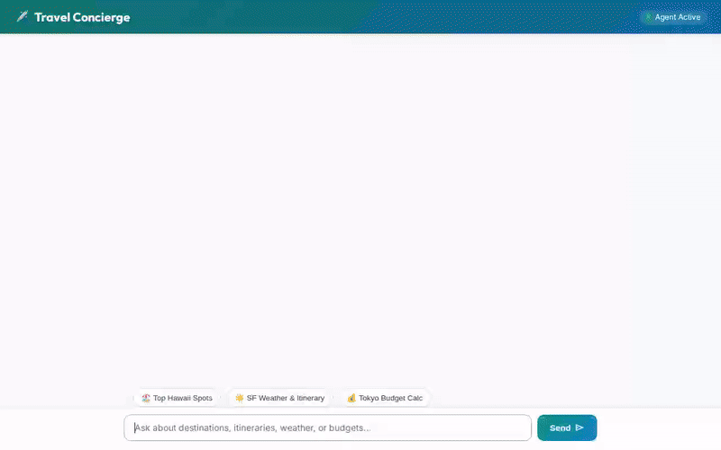

# ✈️ Travel Concierge Agent

An intelligent, full-stack AI travel concierge built with the **Google Agent Development Kit (ADK 1.1.0)** and deployed on **Google Cloud Platform**. The agent assists users with destination discovery, activity recommendations, weather and timezone lookups, budget calculations, foreign currency conversions, address geocoding, nearby place search, scenic media generation, and durable user memory across sessions.



---

## 🌟 Key Features & Capabilities

- **🧠 Multi-Session Durable Memory**: Powered by **Vertex AI Memory Bank**, the agent remembers user preferences, travel history, and critical safety rules (such as dietary restrictions and allergies) across sessions.
- **🗄️ Firestore Destination Management**: Connects to **Google Cloud Firestore** to query and add destination records dynamically.
- **🖼️ AI Scenic Media Generation**: Generates high-resolution destination preview images using `gemini-3.1-flash-lite-image` and short video clips using Google's `gemini-omni-flash-preview` / `veo-3.1-generate-001`.
- **☁️ Cloud Storage Integration**: Automatically stores generated media files in a public **Google Cloud Storage** bucket and returns public HTTPS URLs.
- **🐍 Python Code Execution**: Runs budget calculations and itinerary data analysis inside a secure **Vertex AI Agent Engine Sandbox**.
- **🎨 Adaptive UI (A2UI 0.8)**: Emits structured A2UI JSON cards and surfaces rendered directly in the chat interface.
- **🗺️ Google Maps & Location Tools**: Includes tools for address geocoding (`geocode_address`) and finding nearby places like cafes and attractions (`find_nearby_places`).
- **💱 Live Foreign Exchange**: Converts travel budgets between international currencies using real-time exchange rates (`get_currency_exchange_rates`).
- **💻 Custom FastAPI & Cloud Run Web App**: Features a responsive, ocean-teal branded chat interface deployed on **Google Cloud Run** talking to the agent via the Agent-to-Agent (A2A) protocol.

---

## 🏗️ Architecture & Stack

- **Agent Framework**: Google Agent Development Kit (ADK `1.1.0`)
- **LLM Engine**: `gemini-2.5-flash`
- **Memory**: Vertex AI Memory Bank
- **Database**: Google Cloud Firestore
- **Media Models**: `gemini-3.1-flash-lite-image`, `veo-3.1-generate-001` / `gemini-omni-flash-preview`
- **Storage**: Google Cloud Storage (`gs://...`)
- **Sandbox**: Vertex AI Agent Engine Sandbox Code Executor
- **Frontend**: FastAPI + Vanilla HTML5/CSS3 + Material Symbols
- **Hosting**: Google Cloud Run (Frontend) & Agent Platform Reasoning Engine (Agent Runtime)

---

## 🚀 Local Development & Setup

### Prerequisites
- Python 3.11+
- Node.js 18+ (for frontend dependencies and demo recorder)
- Google Cloud SDK (`gcloud` CLI) authenticated with Application Default Credentials (`gcloud auth application-default login`)

### Running Locally

1. **Install Dependencies**:
   ```bash
   uv sync
   ```

2. **Run Agent Locally**:
   ```bash
   uv run adk run app "Show me available travel destinations"
   ```

3. **Start Local Web Frontend**:
   ```bash
   cd frontend
   python main.py
   ```
   Open your browser to port 8080 to interact with the Travel Concierge interface.

4. **Record a Demo Video**:
   ```bash
   node ../.agents/skills/record-demo/record-agent.js \
     -q "Show me available travel destinations" \
     -q "Generate a scenic preview image of Hawaii" \
     --wait 30000 \
     --speed 1.5 \
     -o agent_demo.webm
   ```
